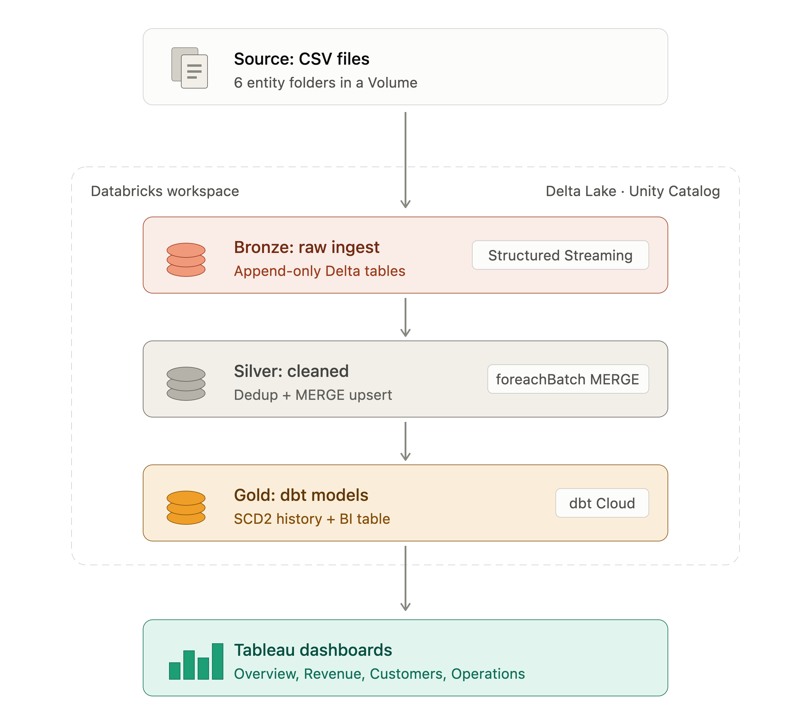
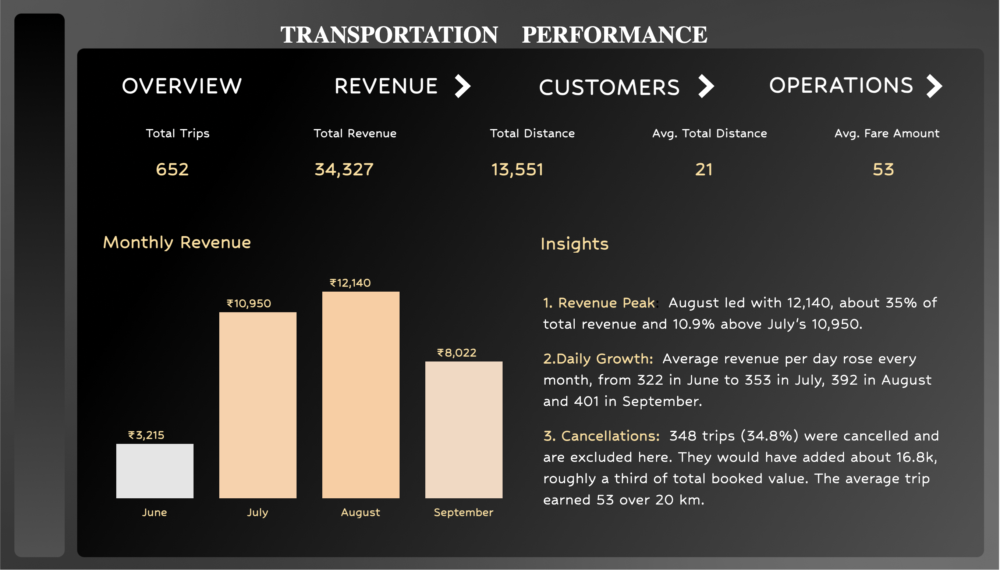
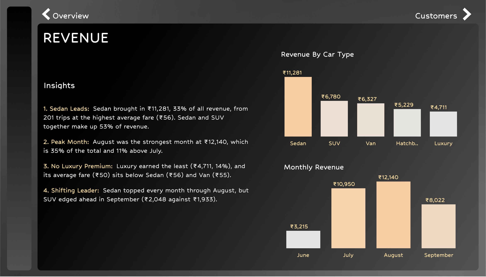
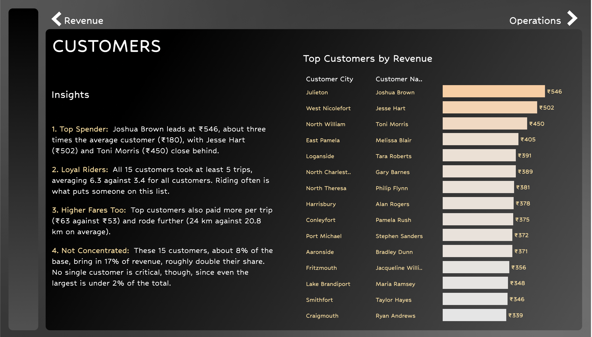
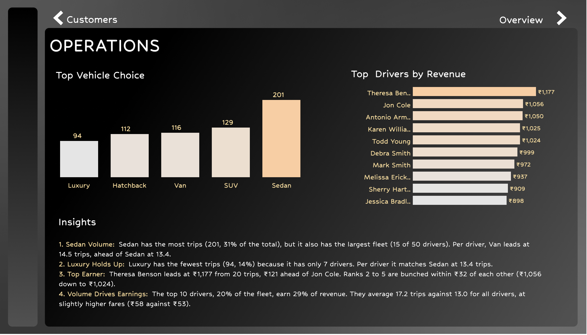

# Ride-Hailing Lakehouse Pipeline with dbt

## 📌 Project Overview

This project implements an end-to-end Lakehouse data engineering pipeline fully inside Databricks, using Apache Spark Structured Streaming and Delta Lake for ingestion and cleansing, and dbt Cloud for the analytics layer. Six ride-hailing entities (customers, drivers, vehicles, trips, payments, locations) arrive as CSV files, flow incrementally through a Bronze–Silver–Gold medallion architecture, and end up as a single BI-ready table that powers a four-page Tableau dashboard.

The objective of this project is to practise real-world modern data engineering workflows: incremental streaming ingestion, deduplication and upserts with Delta MERGE, slowly changing dimensions (SCD Type 2) with dbt snapshots, and point-in-time modeling for BI consumption. The dataset is synthetic.

---

## 🏗️ Architecture Overview

The pipeline follows a Medallion Architecture:

**CSV files (Unity Catalog Volume) → Bronze (Raw Streaming) → Silver (Cleaned + Upserts) → Gold (dbt: SCD2 + BI table) → Dashboard**

Streaming runs up to Silver. dbt is a batch SQL tool, so it reads the Silver tables on a schedule to build Gold.

### Architecture Diagram



---

## ⚙️ Tech Stack

- Apache Spark (Structured Streaming, PySpark)
- Databricks (Unity Catalog, Volumes, serverless SQL warehouse)
- Delta Lake
- dbt Cloud (dbt-databricks)
- Delta MERGE upserts (SCD Type 1 in Silver)
- dbt snapshots (SCD Type 2 in Gold)
- Tableau (Dashboarding)

---

## 🥉 Bronze Layer – Raw Ingestion

- Incremental ingestion of CSV files from a Unity Catalog Volume (one folder per entity)
- One streaming query per entity, created from a single loop over the entity list
- `availableNow` trigger: each run processes only new files, then stops
- Separate checkpoint per entity, stored in a Volume
- Lineage columns added: `_source_file` and `_ingested_at`
- Append-only Delta tables in the `bronze` schema

This layer keeps the data exactly as it arrived and never reprocesses files it has already read.

---

## 🥈 Silver Layer – Deduplication & Upserts

- Config-driven `Transformations` class: each entity only needs a primary key and an ordering column
- `foreachBatch` used to run window logic and MERGE on each micro-batch
- Deduplication inside each batch with `row_number()`, keeping the newest version per key
- Delta MERGE upsert (SCD Type 1): new keys are inserted, and existing rows update only when the incoming record is at least as new as the stored one
- Separate checkpoint per entity
- Clean tables in the `silver` schema

Adding a new entity is one line of configuration, not new code.

---

## 🥇 Gold Layer – dbt Modeling

- dbt Cloud project connected to a Databricks SQL warehouse
- **SCD Type 2 snapshots** for customers, drivers and vehicles, using the timestamp strategy on `last_updated_timestamp`
- Current rows end at `9999-12-31` (`dbt_valid_to_current`), so range joins need no null handling
- **`bi_trip_summary`**: one denormalised table with trip facts plus the customer, driver and vehicle details that were valid when each trip started (point-in-time joins)
- The earliest version of each record counts as valid from the beginning, so trips that predate the first snapshot still match
- Derived fields: trip duration, fare per km, customer and driver names
- Custom `generate_schema_name` macro so models land in the `gold` schema
- Payments and locations are ingested through Bronze and Silver. The BI table currently uses trips plus three dimensions

---

## 📊 Dashboard Visualizations

🔗 **Live Dashboard:**  
[View on Tableau Public](https://public.tableau.com/views/Book1_17917186920520/Overview?:language=en-GB&:sid=&:redirect=auth&:display_count=n&:origin=viz_share_link)

Four linked dashboards were built on the `bi_trip_summary` table, with navigation arrows between pages:

### Overview
<p align="center">
  
</p>

### Revenue
<p align="center">
  
</p>

### Customers
<p align="center">
  
</p>

### Operations
<p align="center">
  
</p>

The dashboards highlight:
- Total trips, distance, revenue, average fare and distance
- Monthly revenue and revenue by vehicle type
- Top customers by revenue
- Trips by vehicle type and top drivers by revenue
- Written insights on each page

Revenue and trip KPIs count Completed and Ongoing trips. Cancelled trips are excluded.

---

## 🚀 Key Engineering Highlights

- Incremental streaming ingestion with checkpoints and `availableNow` triggers
- Config-driven Silver layer using `foreachBatch`, in-batch deduplication and Delta MERGE
- SCD Type 2 history with dbt snapshots
- Point-in-time joins to build a single BI-ready table
- Medallion architecture implemented entirely in Databricks
- Tested with a planted batch of inserts, updates, stale records and in-batch duplicates
- End-to-end validation from source files to dashboard

---

## 🧪 Challenges and Fixes

- **Ordering by processing time.** Using `_ingested_at` as the ordering column let a stale record overwrite newer data and left in-batch duplicates unresolved. Switching customers to the business timestamp (`last_updated_timestamp`) fixed both.
- **How it was tested.** A 68-row test batch (60 new customers, 5 updates, 1 stale record, 2 extra versions of one customer) took Bronze from 200 to 268 rows and Silver from 200 to 260. The stale record was rejected and the five updated customers each got a second version in the SCD2 snapshot.
- **Shared checkpoint paths.** A missing f-string made every stream write to the same checkpoint folder. Fixed by building the path from the entity name.
- **dbt schema naming.** dbt prefixed schema names with a personal dev schema. Fixed with a custom `generate_schema_name` macro.
- **Duplicate keys break MERGE.** A dbt model that read Bronze directly hit duplicate keys, so Gold now reads the cleaned Silver tables.
- **Empty joins on history.** A snapshot's first version starts at that record's own timestamp, so older trips found no match. Fixed by treating each key's earliest version as valid from the beginning.

---

## 🔮 Future Enhancements

- Apply business-timestamp ordering to all entities (validated on customers so far)
- Data quality validation with a quarantine table for bad records
- dbt tests on keys and relationships
- Auto Loader for schema evolution handling
- Workflow orchestration using scheduled Databricks Jobs
- Use payments and locations in the Gold layer

---

## 📁 Repository Structure

```
├── Architecture/    architecture diagram
├── Dashboards/      Tableau dashboard screenshots
├── Notebooks/       Databricks notebooks (Bronze and Silver)
├── dbt/             dbt project (sources, snapshots, BI model, macro)
└── README.md
```

---

## 📎 Conclusion

This project demonstrates modern Lakehouse data engineering principles including incremental streaming ingestion, deduplication and MERGE upserts, SCD Type 2 history with dbt, and point-in-time modeling for BI. It reflects design patterns used in real data platforms, built and debugged end to end.

Sahil Chakraborty ✨
